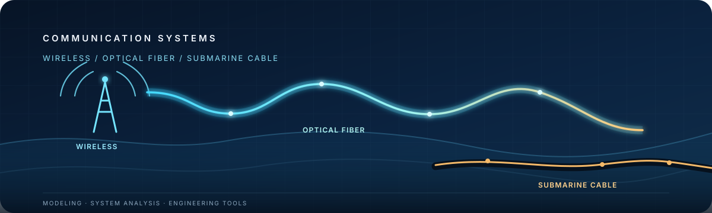

  

<h1 align="center">김희서 | Heeseo Kim</h1>

<strong>Wireless Communications · Optical Fiber · Submarine Cable Systems</strong>

무선부터 광섬유, 해저케이블까지 — 통신 시스템을 모델링하고 성능을 분석합니다.

---

## 연구 분야

| 📡 무선통신 | 🔬 광섬유·광전송 | 🌊 해저케이블 |
|:--|:--|:--|
| MIMO · OFDM 무선 시스템 모델링 | GN 모델 · NLI · GSNR 광섬유 특성과 장거리 전송 | OSNR · 파워버짓 리피터 기반 해저 전송 시스템 |

## 프로젝트

### 통신 시스템과 광전송

- [무선통신·MIMO/OFDM 연구](https://github.com/kimheeseo?tab=repositories) — 통신 시스템 시뮬레이션과 알고리즘 구현
- [Python 기반 광학 해석 도구](https://github.com/kimheeseo/LSCNS/tree/main/COMSOL) — 광도파로 모드 해석과 수치 검증
- [광통신·해저케이블·데이터센터 프로젝트 모음](https://github.com/kimheeseo/LSCNS) — 광전송 시스템과 연결 인프라 관련 작업

### 데이터센터·광 연결 생태계

- [CPO Supply Chain Explorer](https://kimheeseo.github.io/cpo-supply-chain/) · [저장소](https://github.com/kimheeseo/cpo-supply-chain) — CPO 부품·기업·제품 동향 탐색
- [Data Center Design Tool](https://kimheeseo.github.io/LSCNS/DCI/DataCenter/) — 전력과 광 연결을 함께 살펴보는 데이터센터 설계 도구

## 관심 기술

`MIMO` `OFDM` `Optical Fiber` `GN Model` `Submarine Cable` `OSNR` `Python` `MATLAB` `FEM`

Building models and tools for communication systems — from radio links to the ocean floor.

