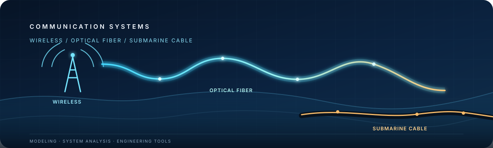

  

<h1 align="center">김희서 | Heeseo Kim</h1>

<strong>Wireless Communications · Optical Transmission · Submarine Cable Systems</strong>

통신 시스템을 모델링하고, 광전송 성능을 분석하며, 복잡한 인프라를 이해하기 위한 도구를 만듭니다.

  <a href="https://kimheeseo.github.io/LSCNS/DCI/DataCenter/LS_Datacenter_3D.html?engine=three">3D 데이터센터 투어</a> ·
  <a href="https://kimheeseo.github.io/LSCNS/COMSOL/universal_silica_v01/web/">광섬유 해석 워크벤치</a> ·
  <a href="https://kimheeseo.github.io/cpo-supply-chain/">CPO Explorer</a> ·
  <a href="https://kimheeseo.github.io/kimheeseo/quiz500/">통신직 학습 도구</a>

---

## 연구 분야

| 분야 | 주요 주제 |
| --- | --- |
| **무선통신** | MIMO · OFDM · 채널 추정 · 통신 시스템 시뮬레이션 |
| **광섬유·광전송** | GN 모델 · 비선형 간섭(NLI) · OSNR/GSNR · 광도파로 모드 해석 |
| **해저케이블 시스템** | 리피터 기반 광전송 · 전력 공급 · 링크 성능과 시스템 예산 |
| **데이터센터·광 연결** | 랙 구성 · Leaf/Spine · MPO/MTP·LC 광배선 · CPO |
| **데이터 기반 연구** | EDFA 이득 예측 · Transformer · 전이학습 · 광섬유 SEM 이미지 분류 |

## 웹에서 사용하는 도구

별도 설치 없이 브라우저에서 실행할 수 있는 시각화·학습 도구입니다.

| 프로젝트 | 주요 내용 | 링크 |
| --- | --- | --- |
| **3D 데이터센터 투어** | 캠퍼스·전력·냉각·네트워크 탐색, 서버·스토리지 랙 내부, 문 열기·닫기와 트레이·카세트 인출, Hot/Cold Aisle 표시 | [실행](https://kimheeseo.github.io/LSCNS/DCI/DataCenter/LS_Datacenter_3D.html?engine=three) · [소스](https://github.com/kimheeseo/LSCNS/tree/main/DCI/DataCenter) |
| **데이터센터 설계·BOM** | 전력·냉각·네트워크·광 연결 구성과 초기 계획 검토 | [실행](https://kimheeseo.github.io/LSCNS/DCI/DataCenter/) · [고객용 간편 설계](https://kimheeseo.github.io/LSCNS/DCI/DataCenter/customer-designer.html) |
| **광섬유 해석 워크벤치** | 광섬유 단면·재료 설정, 모드 특성 분석, 계산 결과 시각화 | [실행](https://kimheeseo.github.io/LSCNS/COMSOL/universal_silica_v01/web/) · [소스·검증 자료](https://github.com/kimheeseo/LSCNS/tree/main/COMSOL/universal_silica_v01) |
| **CPO Supply Chain Explorer** | CPO 구성 부품과 관련 기업·제품·공급망 탐색 | [실행](https://kimheeseo.github.io/cpo-supply-chain/) · [저장소](https://github.com/kimheeseo/cpo-supply-chain) |
| **통신직 준비 도구** | 통신공학·무선공학 문제 풀이, 단원·난이도별 학습, 오답 복습과 면접 자료 | [실행](https://kimheeseo.github.io/kimheeseo/quiz500/) · [소스·이용 안내](./quiz500/) |

> 데이터센터 형상·장비 구성·BOM은 학습 및 초기 검토를 위한 개념 모델입니다. 광섬유 해석의 계산 방식·정확도·제약은 각 프로젝트의 검증 자료를 확인해 주세요.

## 연구 코드와 실험

| 프로젝트 | 연구 내용 | 자료 |
| --- | --- | --- |
| **GN 모델 기반 비선형 전송성능 분석** | 광섬유 유효면적과 입력 광파워에 따른 NLI·GSNR·전송성능 비교 | [2026 KICS Fall](https://github.com/kimheeseo/LSCNS/tree/main/2026_KICS_Fall) |
| **OFC ML Challenge · EDFA Gain Prediction** | 물리 기반 모델, Spectral Transformer, FiLM·FNO 잔차 보정, COSMOS 전이학습 비교 | [연구 코드·평가 기록](https://github.com/kimheeseo/LSCNS/tree/main/26OFC_ML_challenge) |
| **광섬유 SEM 이미지 분류** | 광섬유 파단면 이미지의 전처리·증강과 CNN 분류 실험 | [Fiber SEM Classifier](https://github.com/kimheeseo/LSCNS/tree/main/Fiber_SEM_Classifier) |
| **광통신·해저케이블 연구 모음** | 광전송 시스템, 해저케이블, 광 연결 인프라 관련 코드와 자료 | [LSCNS](https://github.com/kimheeseo/LSCNS) |

EDFA 모델의 내부 검증·공개 데이터 사후 평가와 공식 대회 제출 성적은 구분하여 기록합니다. 세부 실험 조건과 결과는 해당 프로젝트 문서를 참고해 주세요.

## 기술과 관심 주제

**개발·분석:** Python · MATLAB · JavaScript · Three.js/WebGL · 수치해석 · 머신러닝  
**통신·광학:** MIMO · OFDM · Optical Fiber · FEM/FDFD · GN Model · OSNR/GSNR · HCF/MCF · CPO

---

Models, experiments, and interactive tools — from radio links to the ocean floor.

프로젝트 안내 업데이트 · 2026-11-15

